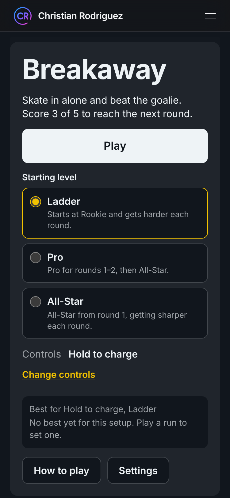
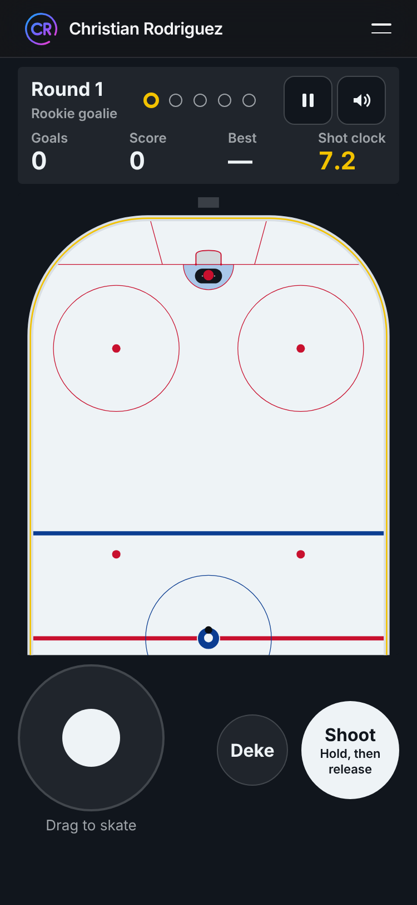
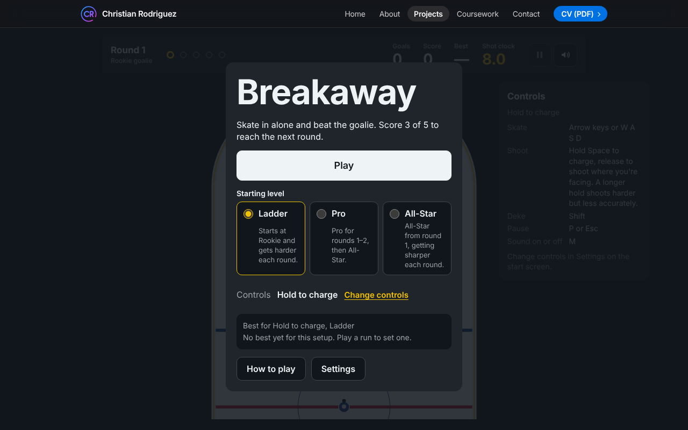
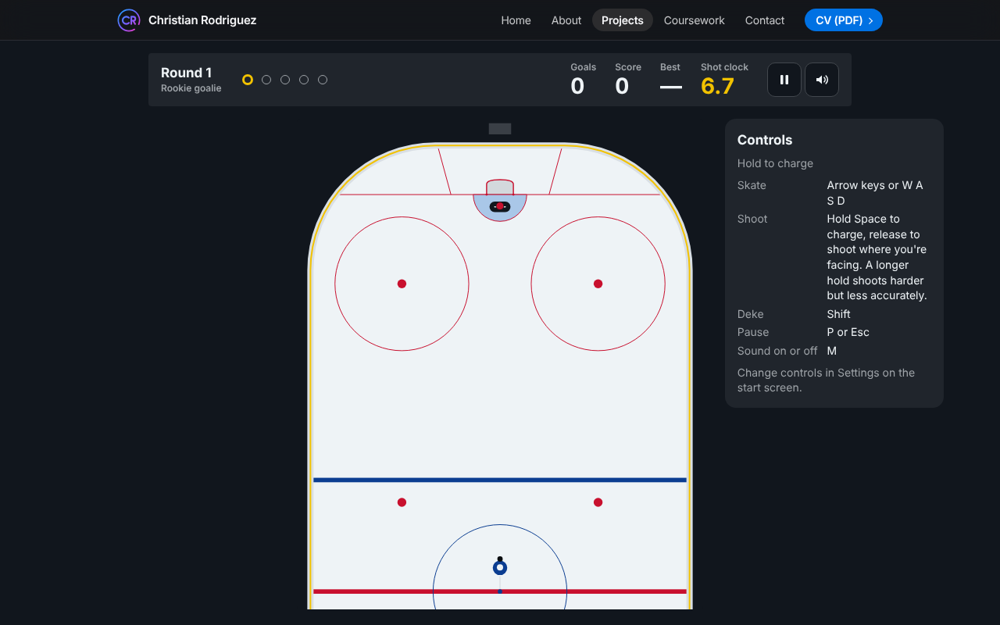

# Breakaway

Breakaway is a top-down hockey shootout against an AI goalie. I skate in from center ice, deke, shoot, and try to score. Each round is 5 attempts and I need 3 goals to reach the next round, against a goalie that gets sharper. I built it in plain JavaScript and Canvas 2D for my portfolio site. It plays in the browser on a laptop or a phone, with nothing to install.

**[Play Breakaway](https://christianrodriguez46.github.io/Projects/Breakaway/)**

| Start screen (phone) | Playing (phone) |
|---|---|
|  |  |

| Start screen (laptop) | Playing (laptop) |
|---|---|
|  |  |

## Versions

I keep every version of the game playable. Each version is a git tag and a release on the [Releases page](https://github.com/ChristianRodriguez46/Breakaway/releases), with a download named for what it is. The Play link above is always the newest version.

| Version | What it is | Download | Code |
|---|---|---|---|
| V1, vector | The game as I first built it: the skater, goalie and puck are drawn with Canvas 2D shapes | [breakaway-v1-vector.zip](https://github.com/ChristianRodriguez46/Breakaway/releases/download/v1.0.0/breakaway-v1-vector.zip) | Branch [`release/v1`](https://github.com/ChristianRodriguez46/Breakaway/tree/release/v1), tag [`v1.0.0`](https://github.com/ChristianRodriguez46/Breakaway/tree/v1.0.0) |
| V2, sprites | The skater, goalie and puck from top-down renders I make in Blender. In development | Not released yet | Branch [`dev`](https://github.com/ChristianRodriguez46/Breakaway/tree/dev) |
| V3, 3D | A 3D version of the game | Planned | |

### Play a download

1. Download the zip for the version you want. To check it, also download its `.sha256` file from the same release and run `sha256sum -c breakaway-v1-vector.zip.sha256` in the folder that holds both. It prints `breakaway-v1-vector.zip: OK`. In PowerShell, `Get-FileHash breakaway-v1-vector.zip` prints the same hash that's in the `.sha256` file.
2. Unzip it. You get a folder with the same name, for example `breakaway-v1-vector`.
3. Open that folder in VS Code and install the **Live Server** extension by Ritwick Dey. Right-click `index.html` and choose **Open with Live Server**. The game opens at http://127.0.0.1:5500/index.html.

Double-clicking `index.html` doesn't work, because browsers won't load the game's modules from `file://`. Without VS Code, any local web server works:

```bash
cd breakaway-v1-vector
python3 -m http.server 4101
```

Then open http://localhost:4101/. Every download has these steps in its `PLAY.md`.

## Features

- **Shootout rounds.** Every attempt starts at center ice with the puck. 3 goals out of 5 moves me to the next round, and the run ends as soon as 3 goals are out of reach. An attempt ends as a Goal, Save, Wide, No shot, Post and out, Poke check or Time (8 seconds per attempt). Details: [Rules and scoring](docs/rules-and-scoring.md).
- **A goalie that thinks.** It squares up to the puck, reacts after a short delay, dives for wide shots, poke-checks a puck carried too close, bites on or reads dekes, and gives up rebounds. There are three levels, Rookie, Pro and All-Star, and All-Star keeps getting sharper after round 5. I can climb the ladder from Rookie or start at Pro or All-Star. Details: [Goalie AI](docs/goalie-ai.md).
- **Hockey physics, sized for a screen.** Skating with acceleration, glide and turning, dekes, charged shots, bounces off the boards and posts, rebounds, and a goal only when the whole puck crosses the line. A fast shot can't slip through a post or the goalie. The rink uses real NHL measurements in feet. Details: [Physics](docs/physics.md).
- **Three control schemes, keyboard and touch.** Hold to charge, Aim with mouse, or One button, each with keyboard and touch controls (see How to play).
- **Scores.** 100 points a goal, 150 if the goalie bit on a deke first. My best score is saved for each control scheme and starting level.
- **Sound, motion and accessibility.** Synthesized sound with a mute key, results read out to screen readers, keyboard-friendly menus, and a reduced-motion setting. Details: [Browser layer](docs/browser.md).
- **Replayable with a seed.** Adding `?seed=123` to the address makes every random choice repeat, so the same inputs play the same game.
- **Private.** The game saves only its settings and best scores in the browser. Nothing is sent anywhere, and there's a button to clear it.

## How to play

I pick one of three control schemes in Settings. The default is Hold to charge.

| Action | Hold to charge | Aim with mouse | One button |
|---|---|---|---|
| Skate | Arrows or WASD | Arrows or WASD | Arrows or WASD |
| Shoot | Hold Space, release to shoot where I'm facing. Longer is faster but less accurate | Click to shoot toward the pointer | Tap Space |
| Deke | Shift | Shift or right mouse button | none |
| Touch | Drag the stick, hold and release Shoot, tap Deke | Drag the stick, tap the rink to shoot, tap Deke | Drag the stick, tap Shoot |

P or Escape pauses. M turns sound on or off. Aim with mouse needs a mouse or a touch screen.

## How I built it

Plain JavaScript ES modules and the Canvas 2D API, with no runtime dependencies and no build step. Node is only used for the tests and development tools.

The code is split in two:

- `src/core/` holds every rule (physics, collisions, goalie AI, scoring, round rules, saved-data checks) as plain functions with no browser code. Random numbers come in through a seeded function.
- `src/browser/` is a thin shell. It runs a fixed-step loop (120 steps a second), reads input, draws the canvas, plays sound, saves settings and announces results to screen readers.

That split is what makes the game testable: the rules run in Node with the same seed every time.

More detail:

- [Decisions](docs/decisions.md): the stack, the loop, the core and shell split, the units, the repository setup and how versions are released.
- Feature docs: [Physics](docs/physics.md), [Goalie AI](docs/goalie-ai.md), [Rules and scoring](docs/rules-and-scoring.md), [Browser layer](docs/browser.md). Each ends with how it's tested. [Releases](docs/releases.md) covers how a version becomes a download.
- [Learning notes](docs/learning/game-loop-notes.md), [physics notes](docs/learning/physics-notes.md), [goalie AI notes](docs/learning/goalie-ai-notes.md), [release notes](docs/learning/releases-notes.md) and [exercises](docs/learning/exercises.md).
- [Setup guide](SETUP.md), [changelog](CHANGELOG.md) and [iteration log](ITERATION_LOG.md).

## Run it locally

The game needs a web server, because browsers won't load ES modules from `file://`.

```bash
git clone https://github.com/ChristianRodriguez46/Breakaway.git
cd Breakaway
npm run serve
```

Then open http://localhost:4101/. VS Code's Live Server works too. [SETUP.md](SETUP.md) has the full setup, including Node and VS Code.

## Publishing

I work on the `dev` branch. Each major version has a release branch (`release/v1` now), and `main` only moves through it, so my site always runs a released version. When an update is finished:

```bash
cd Breakaway
npm test
git switch release/v1 && git pull && git merge dev && git push
git switch main && git merge release/v1 && git push
git switch dev && git merge main && git push
```

Pushing `main` runs the tests on GitHub. If they pass, the `notify-portfolio` workflow tells my portfolio site, which pulls in the new version and republishes it. Pushes to `dev` and to release branches never reach the site.

### Releasing a version

A change to the game also gets a new version before it goes into `main`: on the release branch I set the version in `package.json`, add its section to [CHANGELOG.md](CHANGELOG.md) and update the Versions table, then tag it and publish the tag:

```bash
cd Breakaway
git tag -a v1.0.0 -m "Breakaway V1, vector"
npm run package -- v1.0.0
git push origin v1.0.0
```

`npm run package` builds the same files the release gets, in `dist/`, so I can open the zip before publishing. Pushing the tag runs the `release` workflow: it tests the game, then creates the release with the zip, its checksum and that version's notes from the changelog. Tags never change my site. When the next major version ships, the old one's branch, tags and downloads stay, so every version can still be played; I only change an old version now and then, for a bug fix or a small update. The full steps, including starting a new major version's branch and changing an older version, are in [docs/releases.md](docs/releases.md).

## Project layout

```
Breakaway/
  index.html          the game page
  style.css           the game's styles
  PLAY.md             how to run a download (it goes inside every release zip)
  about.html          the About page on my site
  src/core/           pure rules: physics, goalie, scoring, settings, constants
  src/browser/        loop, renderer, input, touch, audio, storage, UI
  tests/              unit, integration, stats and release tests (tests/site/ is used by my portfolio)
  docs/               decisions, feature docs, learning notes, screenshots
  scripts/serve.sh    the local web server (npm run serve)
  scripts/package-release.mjs   builds a version's download (npm run package -- <tag>)
  .github/workflows/  tests.yml (runs the tests), notify-portfolio.yml (tells my portfolio about a new main),
                      release.yml (publishes a version when I push its tag)
  dist/               downloads built by npm run package (not committed)
  SETUP.md  CHANGELOG.md  ITERATION_LOG.md
```

## Tests

### How I tested it

- **The rules run in Node with a seeded random generator**, so every test plays out the same way each time.
- **Unit tests (151)** check each function on its own: rink geometry, skating, shots, collisions, the goalie, difficulty levels, round rules, scoring, saved data, on-screen text, and that `src/core/` never touches the page.
- **Integration tests (15)** play whole attempts through the game's one-step function: a goal, a save, a rebound goal, a shot off the post, a poke check, running out of time, clearing a round, losing a run early, and pausing.
- **Release tests (8)** check the download builder: tag and version rules, the zip's name, the notes taken from the changelog, which release is "Latest", and a real zip built from a throwaway git repo that must hold only the play files, as committed.
- **Statistics tests (62)** play thousands of scripted shots, dekes and poke attempts with fixed seeds and check that each goalie level behaves as designed. In those scripted shots Rookie gives up about 39%, Pro about 20% and All-Star about 8%.
- **On GitHub:** every push runs `npm test`, and pushing a version tag runs it again before the release is built.
- **By hand:** I checked every screen in a browser at phone and laptop sizes with screenshots.
- **Not covered yet:** touch feel on real phones, audio on devices, and screen readers. There are no automated browser (Playwright) tests yet. `playwright.config.js` is ready, but `tests/e2e/` hasn't been written.

### Run the tests

Run these after `cd Breakaway`. Node 24 is what I use. `npm test` and the feature scripts need no `npm install`.

| Command | What it runs | Expected summary |
|---|---|---|
| `npm test` | Every test: unit, integration, stats and release | `tests 236`, `suites 11`, `pass 236`, `fail 0` |
| `npm run test:physics` | Rink, skater, puck, collisions, vectors and the seeded random | `tests 77`, `pass 77`, `fail 0` |
| `npm run test:goalie` | Goalie behavior, difficulty levels, goalie statistics | `tests 86`, `suites 11`, `pass 86`, `fail 0` |
| `npm run test:rules` | Round rules, scoring, saved data, whole attempts | `tests 48`, `pass 48`, `fail 0` |
| `npm run test:browser` | On-screen text, and the core never touching the page | `tests 17`, `pass 17`, `fail 0` |
| `npm run test:release` | The download builder for releases | `tests 8`, `pass 8`, `fail 0` |

### Expected output

Each passing test prints a line starting with ✔, and the run ends with a summary. For `npm test`:

```
✔ goal: shot past a parked goalie scores 100 and shows the banner (6.3ms)
✔ save: shot into a parked goalie with no rebound roll is a save and the puck is frozen (0.7ms)
...
✔ parseSeedParam accepts whole numbers in range and rejects anything else (0.4ms)
ℹ tests 236
ℹ suites 11
ℹ pass 236
ℹ fail 0
ℹ cancelled 0
ℹ skipped 0
ℹ todo 0
ℹ duration_ms 933
```

The times differ on every run. A failing test prints ✖ with the expected and actual values, and the summary shows `fail` above 0.

## License

My code is under the MIT license. See the LICENSE file.
