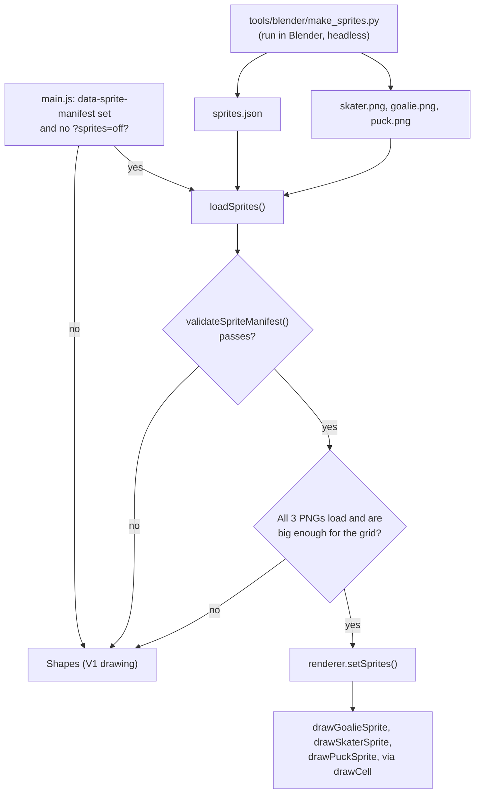

# Sprites

The V2 look: the skater, goalie and puck drawn from pictures that I render in Blender, instead of the circles and lines of V1. The shapes are still in the game as the fallback.

## What it does

A Blender script builds the three characters from simple 3D shapes and renders each one from straight above into a transparent PNG strip: eight skating frames, five goalie poses and one puck. It also writes `sprites.json`, which says how big each cell is, what order the frames are in, where the skater's hand is in each frame and how far each goalie pose reaches. The game loads those files, checks them, and draws the right cell for what is happening. If anything is missing or wrong, it draws the shapes, and the rink never goes blank.

Only drawing changes. Sizes, speeds and reach in the physics stay the same, and the goalie's drawn pads are scaled to match the pads the physics uses.

## How it works



### The Blender script (`tools/blender/make_sprites.py`)

Run headless, it does these steps in `main()`:

1. `parse_args()` reads `--out`, `--samples` and `--blend` from the arguments after `--`.
2. `remove_previous_run()` deletes everything an earlier run made. Every name the script creates starts with `bk_`, so re-running is safe.
3. `make_scene()` sets up a Cycles scene on the CPU with a transparent background and the Standard view transform, so the PNG colors match the hex colors. `make_world()` adds a dim white sky light.
4. `build_stage()` adds the top-down orthographic camera, an overhead sun and an ice plane that is a shadow catcher: it shows only the shadows on the transparent PNG.
5. `make_material()` makes a Principled BSDF material for each entry in `COLORS`, using `hex_to_linear()` to convert the sRGB hex to the linear color Blender expects.
6. `build_skater()` builds one skater per stride frame, each a character rig with legs driven by a `phase` property (`add_phase_driver()`). Frame `i` has phase `2π × i / 8`, and the two legs are half a cycle apart.
7. `build_goalie()` builds one goalie per entry in `GOALIE_POSES`. The dive pose is rolled onto its side and lifted. `body_point()` finds the blocker's grip point in the body's space, so the stick shaft starts at the hand.
8. `build_puck()` builds the puck from a cone with equal radii (a cylinder) and a Bevel modifier.
9. `cell_offsets()` spaces each strip's characters one cell apart, centered on the camera.
10. `read_hand_points()` reads where the skater's lower glove ends up in each frame, after the drivers have run, and converts it to canvas feet.
11. `render_strip()` hides every collection except one, sets the camera's `ortho_scale` to `columns × cell_size_ft` and the image size to `columns × cell_size_px` by `cell_size_px`, and renders one PNG per strip. `clean_alpha()` then reopens each PNG and makes the shadow catcher's faint far-off shadow fully transparent and fades each cell's border to 0, so no gray square shows around a player in the game.
12. `build_manifest()` and `main()` write `sprites.json`, and save a `.blend` when `--blend` is given.

The camera looks straight down. One Blender unit is one game foot. Sprites face +X, which is angle 0 on the canvas, and Blender +Y is canvas -y. The concepts are explained in [learning/blender-sprites-notes.md](./learning/blender-sprites-notes.md).

### Loading (`src/browser/sprites.js`)

`loadSprites({ manifestUrl })` fetches `sprites.json`, passes it to `validateSpriteManifest()`, then loads the three PNGs named in it, resolved next to the manifest. It also checks that each image is at least `columns × cell_size_px` wide and `rows × cell_size_px` tall. It never throws: any problem returns `null`. The fetch and image loaders can be passed in, which is how the unit tests run it without a browser.

### The rules (`src/core/sprites.js`)

Pure functions, tested in Node:

- `validateSpriteManifest(raw)` checks every field of the parsed `sprites.json` (see the table below) and returns the manifest with camelCase names, or `null`. It never throws.
- `getCellRect(sheet, index)` gives the pixel rectangle of a cell: left to right, then down.
- `getSkaterFrame(sheet, distanceFt, speedFtPerS)` picks the stride frame from the distance skated, so the legs keep pace with the ice. Below `SPRITE_GLIDE_BELOW_FT_PER_S` it returns frame 0, the glide.
- `getGoaliePose(mode)` maps the goalie's mode to a pose: set, tracking and reacting use `stance`; diving uses `dive`; poking uses `poke`; bitten uses `lean`; recovering uses `butterfly`.
- `getGoalieFacingRad(puckAt)` is the angle from the net toward the puck.
- `getGoalieMirror(goalie, puckAt, sidePoseY)` returns 1 or -1: whether to flip a dive or lean so it points where the physics reaches. Other poses are never flipped.
- `getGoalieSpriteScale(sheet, pose, reachFt, spriteScale)` returns the size along and across the pads, so the drawn pads are as wide as the shapes' pads while the goalie dives.
- `isSpritesParamOff(search)` is true for `?sprites=off`.

### Drawing (`src/browser/renderer.js`)

- `setSprites(loaded)` stores the loaded sheets (or `null` for the shapes) and redraws.
- `trackStride(at)` adds each frame's skater movement to a distance. A jump bigger than `SCRATCH_RESET_FT` means a new attempt and resets it.
- `drawCell(...)` copies one cell onto the canvas: move to the position, turn to the angle, scale, and `drawImage` the cell as `cell_size_ft` feet across. A negative across-scale mirrors it.
- `drawGoalieSprite(...)` draws the pose for the goalie's mode, facing the puck, mirrored for dives and leans.
- `drawSkaterSprite(...)` draws the stride frame, plus a drawn stick line from the sprite's glove to the puck, so the stick always reaches the puck whatever the frame.
- `drawPuckSprite(...)` draws the puck cell and nothing when the goalie has covered the puck. Its shadow is baked into the PNG.

When sprites are on, `draw()` uses these instead of the shape functions, with image smoothing on.

### The switch (`main.js`)

`main.js` reads `data-sprite-manifest` from the game root. If it is set and the URL doesn't have `?sprites=off`, it calls `loadSprites()` and, when that returns sheets, `renderer.setSprites()`. The shapes show until the sheets arrive and stay if they never do.

### `sprites.json`

One `schema_version` and a `sheets` object with `skater`, `goalie` and `puck`.

| Field | Meaning | What the validator enforces |
|---|---|---|
| `schema_version` | Version of this file format | Must equal `SPRITE_SCHEMA_VERSION` (1) |
| `sheets.<name>.file` | PNG file name, next to the manifest | Lowercase letters, digits, `_` and `-`, ending `.png`, no folders and no `..` |
| `cell_size_ft` | How many feet one cell covers on the rink | A number above 0, at most `SPRITE_CELL_FT_MAX` |
| `cell_size_px` | Pixels per cell side in the PNG | A whole number from 8 to `SPRITE_CELL_PX_MAX` |
| `columns`, `rows` | The grid of cells | Whole numbers from 1 to `SPRITE_GRID_MAX` |
| `skater.frame_count` | Number of stride frames | A whole number from 1 to `columns × rows` |
| `skater.stride_length_ft` | Distance for one full stride cycle | Above 0, at most 100 |
| `skater.hand_ft` | The lower glove per frame, in feet from the skater's center (x forward, y to the right) | An array with exactly `frame_count` entries; each `x` and `y` a finite number whose absolute value is at most `cell_size_ft` |
| `goalie.side_pose_y` | Which way the sheet's dive and lean poses point (1 is canvas +y) | Exactly 1 or -1 |
| `goalie.poses.<pose>.index` | Cell number of the pose, counted left to right, then down | All five poses present (stance, butterfly, poke, lean, dive); a whole number from 0 to `columns × rows - 1` |
| `goalie.poses.<pose>.reach_ft` | How far the pose reaches across | Above 0, at most the goalie's `cell_size_ft` |

## Settings

The script's settings block (`tools/blender/make_sprites.py`):

| Setting | Value | What it does |
|---|---|---|
| `OUT_DIR` | `assets/sprites` | Default output folder |
| `SAMPLES` | 64 | Cycles samples per pixel (`--samples`) |
| `SUN_STRENGTH` | 2.2 | Sun brightness |
| `SUN_ANGLE_DEG` | 12 | Sun size in degrees; a bigger sun makes softer shadows |
| `WORLD_STRENGTH` | 0.3 | Brightness of the white sky light |
| `IS_SHADOW_ON` | `True` | Adds the shadow-catching ice plane |
| `FAINT_SHADOW_ALPHA` | 0.06 | Shadow fainter than this becomes fully transparent (`clean_alpha()`); the rest is rescaled so there is no hard edge |
| `CELL_EDGE_FADE_PX` | 3 | Pixels over which each cell's border fades to transparent |
| `COLORS`, `ROUGHNESS`, `METALLIC`, `SPECULAR` | hex colors, e.g. jersey `#0b3d91`, goalie helmet `#c8102e`; puck specular 0.1 | Material colors and shine by name. The puck's low specular keeps the overhead sun's reflection from turning its top gray |
| `SKATER_CELL_FT`, `SKATER_CELL_PX` | 5.0 ft, 128 px | Skater cell size |
| `STRIDE_FRAMES` | 8 | Frames in the stride |
| `STRIDE_LENGTH_FT` | 7.0 | Distance skated per full cycle |
| `LEG_PUSH_OUT_DEG`, `LEG_PUSH_BACK_DEG` | 45, 30 | How far the pushing leg swings out and back |
| `SKATE_TOE_OUT_DEG` | 25 | Toe turn-out of the pushing skate |
| `SHOULDER_SWAY_DEG` | 8 | Shoulder sway through the stride |
| `FORWARD_LEAN_DEG` | 20 | Upper body lean |
| `GOALIE_CELL_FT`, `GOALIE_CELL_PX` | 8.0 ft, 192 px | Goalie cell size |
| `GOALIE_POSES` | stance, butterfly, poke, lean, dive | Per pose: `reach_ft`, `hip_z_ft`, `knee_z_ft`, `knee_gap_ft`, `pad_flare_deg`, `lean_deg`, `side_lean_deg`, `stick_reach_ft` |
| `DIVE_ROLL_DEG`, `DIVE_LIFT_FT` | 80, 1.7 | How far the dive pose rolls onto its side and how high it is lifted |
| `PUCK_CELL_FT`, `PUCK_CELL_PX` | 1.5 ft, 48 px | Puck cell size |
| `PUCK_RADIUS_FT`, `PUCK_THICKNESS_FT` | 0.5, 0.33 | Puck size; the radius matches the game's puck |
| `PREFIX` | `bk_` | Start of every name the script makes, used to clean up |

The game's side (`src/core/constants.js`):

| Constant | Value | What it does |
|---|---|---|
| `SPRITE_SCHEMA_VERSION` | 1 | The only `schema_version` the game accepts |
| `SPRITE_GLIDE_BELOW_FT_PER_S` | 4 ft/s | Below this speed the skater shows the glide frame |
| `SPRITE_CELL_PX_MAX` | 1024 px | Largest `cell_size_px` allowed |
| `SPRITE_CELL_FT_MAX` | 20 ft | Largest `cell_size_ft` allowed |
| `SPRITE_GRID_MAX` | 64 | Most columns or rows allowed |
| `GOALIE_SPRITE_POSES` | stance, butterfly, poke, lean, dive | The poses `sprites.json` must list |

## Switching it on and off

- **On (now):** the game root in `index.html`, `<main id="main" ...>`, has `data-sprite-manifest="assets/sprites/sprites.json"`. The path is relative to the page. The sheets in `assets/sprites/` are the ones I rendered with Blender 5.2 LTS.
- **Off for the site:** remove the attribute. The game draws shapes and never asks for the files.
- **Off for one visit:** add `?sprites=off` to the address. This also works for comparing the two looks side by side.

## Making the sheets

I render with Blender 5.2 LTS; I haven't tried older versions. From the repo, with Blender on the path:

```bash
cd Breakaway
blender -b --factory-startup -P tools/blender/make_sprites.py -- --out assets/sprites
```

- `-b` runs Blender without a window; `--factory-startup` ignores my own Blender settings and add-ons, so the result is the same everywhere; `-P` runs the script. Everything after `--` is for the script.
- `--samples 16` makes a quick, noisier draft. The default is 64.
- `--blend sprites.blend` also saves the scene, so I can open it in Blender and look at the characters. It saves a copy, so the open scene stays as it was.
- Without `--out`, the files go to `assets/sprites` in the game folder when the script is in `tools/blender`, and to a `breakaway-sprites` folder next to the script anywhere else (in my home folder for a script that was never saved to a file).

It writes `skater.png`, `goalie.png`, `puck.png` and `sprites.json` in that folder. Rendering is on the CPU, so a draft takes a short while and the full run takes longer.

**Inside Blender instead of a terminal.** In the **Scripting** tab, **Text > Open** the script, then press **Run Script** (▶, or Alt+P over the editor). There are no command options there, so the settings block at the top of the script (`SAMPLES` and the rest) is where I change things, and the files go to the default folder above. On Windows, **Window > Toggle System Console** shows the script's messages and any error. After a run, the `bk_sprites` scene in the scene list holds the characters, so I can look at them in the viewport and drag a skater root's `phase` custom property to see the stride drivers work. Running it again replaces the old `bk_` objects.

## Troubleshooting

| Problem | Likely cause | What to do |
|---|---|---|
| The game draws shapes | `data-sprite-manifest` isn't on `main#main`, the URL has `?sprites=off`, or a file failed a check | Open DevTools, Network: `sprites.json` and the three PNGs should all be 200. Then compare `sprites.json` with the table above |
| Shapes only, and the files load | `sprites.json` failed `validateSpriteManifest()`, or a PNG is smaller than `columns × cell_size_px` by `rows × cell_size_px` | Run the sprite-assets test (below), which runs the same checks |
| Legs run too fast or too slow for the skating speed | `stride_length_ft` | Change `STRIDE_LENGTH_FT` in the script and re-render |
| The goalie dives the wrong way | `side_pose_y` | It must say which way the sheet's dive and lean poses point; `build_goalie` points them to Blender -Y, which is canvas +y, so it is 1 |
| Blender says `No module named bpy` | The script was run with plain Python | Run it with `blender -b ... -P`, or from Blender's Text Editor |
| `PermissionError` when run from the Text Editor | An older copy of the script, which used `__file__` (in the Text Editor that isn't the file's real path) | Use the current script; `script_file()` reads the path from the Text Editor |
| Images look jagged or soft | Sample count or image size | Raise `--samples`, or `cell_size_px` and re-render |
| An edit to a color or pose doesn't show | The browser kept the old PNG | Hard refresh (Ctrl+Shift+R) |
| A faint gray square around each player | Sheets rendered before `clean_alpha()` was added | Re-render with the current script |
| The puck's top looks gray, not black | The flat top reflects the overhead sun straight into the camera | Lower the puck's `SPECULAR` value and re-render |

## How it's tested

| Check | Tests | What it checks |
|---|---|---|
| `tests/unit/sprites.test.js` | 11 | Runs in `npm run test:browser`. (1) `validateSpriteManifest` accepts the script's output and returns camelCase names. (2) It returns `null` for junk without throwing. (3) It rejects file names with folders, other file types or capitals. (4) It rejects out-of-range sizes, indexes and hand points. (5) `getCellRect` walks the grid left to right, then down. (6) `getSkaterFrame` follows the distance skated and shows the glide frame when slow. (7) `getGoaliePose` covers every goalie mode, with stance as the fallback. (8) `getGoalieFacingRad` points from the net to the puck. (9) `getGoalieMirror` flips dives and leans to the side they go and never flips other poses. (10) `getGoalieSpriteScale` makes the drawn pads as wide as the shapes' pads. (11) `isSpritesParamOff` reads only `?sprites=off` |
| `tests/unit/sprite-assets.test.js` | 6 | When `index.html` switches sprites on, the manifest file exists, passes `validateSpriteManifest`, and every PNG it names exists and is at least `columns × cell_size_px` wide and `rows × cell_size_px` tall, read from the PNG header. That test is the one on the real repo, so it checks the sheets in `assets/sprites/`; if I ever remove the attribute, it passes without checking anything. The checker is `checkSpriteAssets(rootDir)` in `tests/helpers/sprite-assets.js`. The other five tests run it on temporary folders: a valid set, the attribute absent, a missing, broken or invalid manifest, missing, too-small or non-PNG files, and bad paths. `npm run test:browser` runs this file too |
| By hand in a browser | | With stand-in sheets (see below) |
| By hand in Blender | | A real render on my laptop |

The loader (`loadSprites`) and the renderer's sprite drawing have no automated tests, because they need a browser.

**Manual browser check.** I put stand-in sheets in `assets/sprites/`, set `data-sprite-manifest`, serve the game and look at:

- The skating frames advance with the distance skated and stop on the glide frame when I stand still.
- The goalie shows each pose, and dives and leans mirror toward the side they go.
- The puck draws, and disappears when the goalie covers it.
- `?sprites=off` gives the shapes.
- With a PNG deleted or `sprites.json` broken, the shapes show instead.
- The DevTools console has no errors, at 375 px wide and at 1280 px wide.

**The Blender script.** The tests can't run Blender's pictures: a stub run proves the script's logic, not how the characters look. So the script is checked by a real render on my laptop, and I look at the PNGs.

Run the tests:

```bash
cd Breakaway
npm run test:browser
npm test
```

## Changelog

- 2026-11-05: Wrote this page: the Blender script, the loader, the rules in `src/core/sprites.js`, the renderer's sprite drawing, `sprites.json`, the settings, switching on and off, troubleshooting and tests.
- 2026-11-05: Added `tests/unit/sprite-assets.test.js`, which checks the sheets and manifest whenever `index.html` switches sprites on.
- 2026-11-05: Switched sprites on: `index.html` points at `assets/sprites/sprites.json`, with the sheets from my second Blender 5.2 render.
- 2026-11-05: After the first real render: `clean_alpha()` removes the faint gray square the shadow catcher left around each player, and the puck's specular is lowered so it renders black instead of gray.
- 2026-11-05: The script runs from Blender's Text Editor too (`script_file()`, the default output folder, switching away from `bk_sprites` before re-running), sets the image `media_type` that Blender 5.0 added, and names Blender 5.2 LTS as the version I render with.